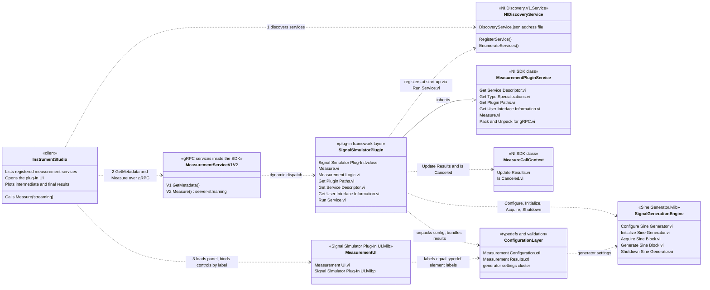
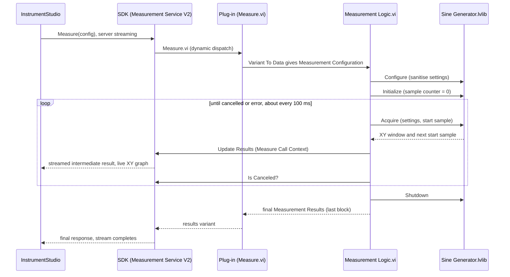

# Signal Simulator architecture

The Signal Simulator is a LabVIEW **Measurement Plug-In SDK** (MeasurementLink) plug-in. It needs no
hardware: it synthesises a sine wave and streams it to InstrumentStudio (or any MeasurementLink client)
as a continuously scrolling XY graph.

## Project layout

```
Signal Simulator.lvproj                 LabVIEW project (class, two libraries, UI packed-library build spec)
Signal Simulator Plug-In/               Plug-in framework layer (one class, derived from the NI SDK)
  Signal Simulator Plug-In.lvclass        Measurement Plugin Service child class
  Measurement Configuration.ctl           Configuration typedef  (client -> plug-in)
  Measurement Results.ctl                 Results typedef        (plug-in -> client)
  Measurement Logic.vi                    Orchestrates initialize / configure / acquire / shutdown
  Signal Simulator.measui                 InstrumentStudio (Measurement Plug-In UI) user interface
  Signal Simulator.measui                 InstrumentStudio (Measurement Plug-In UI) user interface
  Measure.vi, Get Plugin Paths.vi, ...    Framework overrides (see below)
Sine Generator/                         Signal generation engine (no framework dependencies)
  Sine Generator.lvlib
    Configure Sine Generator.vi           Configuration  - sanitise the five settings
    Initialize Sine Generator.vi          Initialization - reset the sample counter
    Acquire Sine Block.vi                 Acquisition    - produce one XY window, advance the start sample
    Generate Sine Block.vi                Engine         - the sine maths
    Shutdown Sine Generator.vi            Shutdown       - finalise the run
Signal Simulator Plug-In UI/            User interface layer
  Signal Simulator Plug-In UI.lvlib
    Measurement UI.vi                     Front panel shown by InstrumentStudio
Signal Simulator Plug-In/BuiltUI/       (generated, git-ignored) Signal Simulator Plug-In UI.lvlibp
docs/                                   This documentation
```

The engine library knows nothing about gRPC, the SDK or InstrumentStudio, so it can be tested or reused
on its own. The plug-in class is the only place where the SDK is touched.

## Architecture diagram



## Run-time sequence (one measurement)



## Staged components (SDK best-practice layout)

| Stage | VI | Responsibility |
|---|---|---|
| Configuration | `Configure Sine Generator.vi` | Coerces the settings: amplitude >= 0, sample rate 1 S/s .. 10 MS/s, frequency 0 .. Nyquist, number of samples 2 .. 1 000 000, update interval 10 .. 10 000 ms. Returns one `generator settings` cluster. |
| Initialization | `Initialize Sine Generator.vi` | Starts a run: sample counter = 0, so the first window starts with zero phase. Nothing to open, because there is no hardware. |
| Acquisition | `Acquire Sine Block.vi` calls `Generate Sine Block.vi` | Produces one XY window and returns the next start sample (`start + sample rate x update interval`), so successive windows scroll the wave in real time. |
| Shutdown | `Shutdown Sine Generator.vi` | Finalises the run and reports the samples elapsed. The single place to release resources if the engine ever acquires any. |
| Orchestration | `Measurement Logic.vi` | Runs the four stages, publishes each window with `Update Results`, polls `Is Canceled`, returns the last window as the final result. |

## Signal definition

`i` is the sample index inside the window, `n = start sample + i`, `Fs` the sample rate, `A` the amplitude
and `f` the frequency.

| Output | Definition |
|---|---|
| `y_data` | `A * sin(2*pi * frac(f*n/Fs))` (the fractional part keeps the argument small, so long runs do not lose precision) |
| `x_data` | `i / Fs` in seconds, always starting at 0, so the time axis of the graph is stable and always spans `(Number of Samples - 1) / Fs` |

## Configuration and results

| Direction | Element | Type | Default | Notes |
|---|---|---|---|---|
| Configuration | `Amplitude` | double | 1 | peak value, V |
| Configuration | `Frequency` | double | 10 | Hz |
| Configuration | `Sample Rate` | double | 1000 | S/s |
| Configuration | `Number of Samples` | uint32 | 1000 | samples per window; with the sample rate this sets the width of the time axis |
| Configuration | `Update Interval` | uint32 | 100 | ms between published windows |
| Results | `Waveform` | `ni_protobuf_types_DoubleXYData` (x_data, y_data) | | time in seconds vs. value |
| Results | `Total Samples` | double | | samples elapsed since the run started |

The defaults are stored in `Measurement Configuration.ctl`; InstrumentStudio shows them when the panel is
opened. Without stored defaults every numeric would start at 0 (sample rate 0 and amplitude 0 give a flat line).

## Graph axes

The graph in `Signal Simulator.measui` is the standard InstrumentStudio array graph with the graph toolbar
(horizontal zoom, vertical zoom, pan, reset) and the optional plot, cursor and scale legends.

- **Time axis:** `Time (s)`, fitted exactly to the data. Its span is set by `Number of Samples / Sample Rate`.
- **Amplitude axis:** `Amplitude (V)`, fitted loosely so the wave never touches the frame. Its span follows `Amplitude`.
- Both axes can also be changed by the user in InstrumentStudio (zoom, pan, fixed ranges); **Reset** returns
  to the automatic ranges.

This follows the NI examples: the XY result is plotted by binding the graph's plot to the `Waveform` output
(`Game Of Life` does the same with its `game of life` XY cluster), and the logic publishes a complete
window on every `Update Results` call because InstrumentStudio keeps no history.

## Most important classes, APIs and VIs

| Item | Kind | Why it matters |
|---|---|---|
| `Measurement Plugin Service.lvclass` (NI SDK) | Parent class | Defines the overridable framework methods; the plug-in class derives from it. |
| `Signal Simulator Plug-In.lvclass` | Plug-in class | Holds every framework override and the two typedefs. |
| `Run Service.vi` (plug-in and SDK) | Entry point | Creates the gRPC services, registers with the discovery service and blocks until stopped. |
| `Get Service Descriptor.vi` | Override | Display name, version, description and the unique `service class` string used for discovery. |
| `Get Plugin Paths.vi` | Override | Tells the framework which VI and ctl files are the logic, configuration and results. |
| `Get User Interface Information.vi` | Override | Returns `Signal Simulator.measui` first and the LabVIEW panel `BuiltUI\Signal Simulator Plug-In UI.lvlibp\Measurement UI.vi` second. |
| `Get Type Specializations.vi` | Override | Pin, path and enum specialisations; none needed. |
| `Measure.vi` | Override | Converts the configuration variant to the typedef, calls the logic, returns results as a variant. |
| `Pack for gRPC.vi`, `Unpack for gRPC.vi` | Override | Serialisation helpers for the gRPC messages. |
| `Measure Call Context.lvclass` : `Update Results.vi` | SDK API | Streams an intermediate result to the client; **this is how live data reaches InstrumentStudio**. |
| `Measure Call Context.lvclass` : `Is Canceled.vi` | SDK API | Cancellation polling; ends the acquisition loop when the client presses Stop. |
| `Measurement Logic.vi` | Plug-in VI | Orchestrates the staged components. |
| `Generate Sine Block.vi` | Engine VI | All signal mathematics. |
| `Measurement Configuration.ctl`, `Measurement Results.ctl` | Typedefs | The contract with the client. Members of the plug-in class. |
| `ni_protobuf_types_DoubleXYData.ctl` | Typedef (NI) | Marks the result as XY data so clients render a graph. |

`Signal Measurement Complete.vi` and `Wait Until Cancelled or Complete.vi` are template scaffolding kept in
the class. They are not used: cancellation is polled directly inside the acquisition loop.